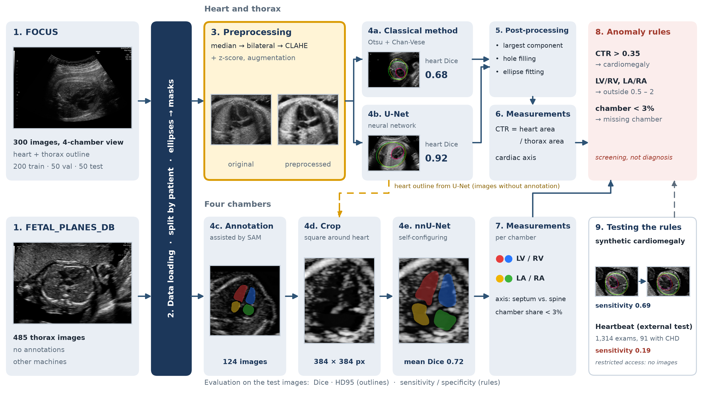
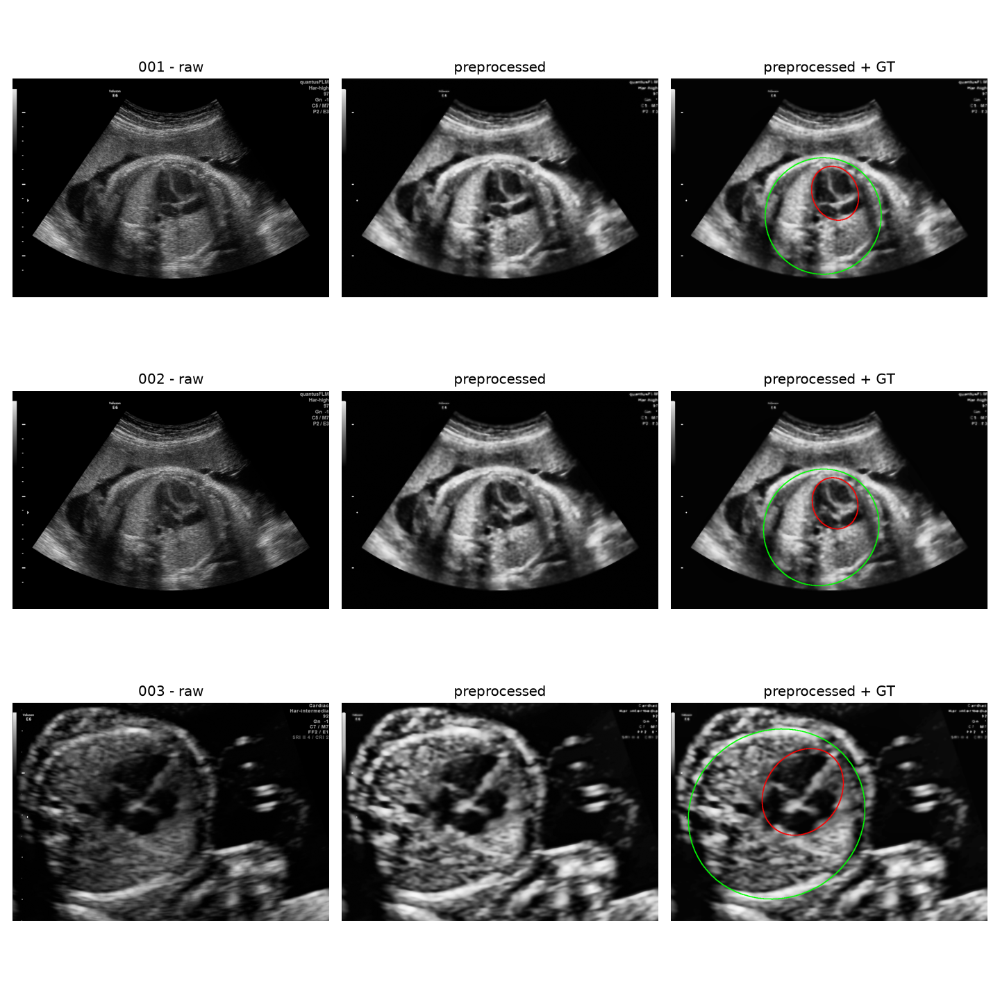
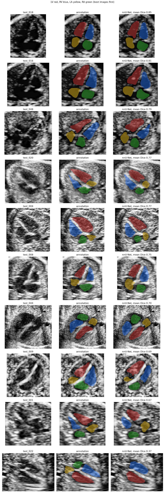

# Fetal Echocardiography

Segmentation of Cardiac Structures (the Four Chambers of the Fetal Heart) in 2D Ultrasound Images and Detection of Congenital Anomalies

## Project Description


## State of the Art

Analysis of similar articles / applications / projects from the last 5 years.

## Literature review

| No. | Author(s) / Year | Title of the article / project | Application / Domain | Technologies used | Methodology / Approach | Results | Limitations | Additional comments |
|-----|------------------|--------------------------------|----------------------|-------------------|------------------------|---------|-------------|---------------------|
| 1 | Zhang et al. / 2025 | [You Can Detect It: Fetal Biometric Estimation Using Ellipse Detection](https://papers.miccai.org/miccai-2025/paper/5236_paper.pdf) + [FOCUS dataset](https://doi.org/10.5281/zenodo.14597550) | Finding the heart and the chest on fetal four-chamber ultrasound images and computing the heart-to-chest ratio (CTR) | PyTorch, ResNet50, U-Net, TransUNet | They detect the heart and the chest as ellipses instead of drawing exact contours. They also publish the FOCUS dataset (300 images with labels) | Dice 93.2% for the heart and 94.9% for the chest. U-Net got 89.1% and 94.0% | Only 300 images, all from one source | This is the dataset I use in my project, so I can compare my U-Net with their results |
| 2 | Le et al. / 2026 | [Ultra-ECP: Ellipse-Constrained and Point-Robust Foundation Model Adaptation for Fetal Cardiac Ultrasound Segmentation](https://proceedings.mlr.press/v315/le26a.html) | Segmenting the fetal heart and chest on the four-chamber view | UltraSAM (a "Segment Anything" model for ultrasound), LoRA | They take a large pretrained model and fine-tune only a small part of it. The user clicks a point and the model segments the region | Dice 95.1% for the chest and 92.6% for the heart on FOCUS | Not fully automatic (needs a click); the code is not public | Best result I found on FOCUS, useful as a target for my methods |
| 3 | Liang et al. / 2024 | [Automatic segmentation of 15 critical anatomical labels and measurements of cardiac axis and cardiothoracic ratio in fetal four chambers using nnU-NetV2](https://doi.org/10.1186/s12911-024-02527-x) | Segmenting 15 parts of the fetal heart and measuring the heart axis and the CTR | nnU-NetV2 | They segment the image, then fit lines and ellipses on the masks to get the measurements. They compare the results with doctors | Average Dice 87.1%. The CTR was close to what experienced doctors measured | Private data from one hospital; the heart axis was less accurate than the doctors | Shows how to get a medical measurement from a segmentation mask, like I do in my project |
| 4 | Li et al. / 2025 | [DCD: A Semantic Segmentation Model for Fetal Ultrasound Four-Chamber View](https://arxiv.org/abs/2506.08534) | Multi-class semantic segmentation of 13 anatomical structures in the fetal heart four-chamber view (4CH) | PyTorch, DeepLabv3+, Xception, CBAM, Dense ASPP | Enhanced DeepLabv3+ architecture with Xception backbone, CBAM attention modules, and Dense ASPP for fine boundary capture; trained with a hybrid loss ($L_{\text{CE}} + L_{\text{Dice}}$) | High mIoU and Dice scores across all 13 anatomical classes, significantly outperforming standard U-Net and DeepLabv3+ | High computational complexity during training due to the 13 anatomical classes | Provides a strong architectural baseline for detailed multi-class chamber segmentation in the 4CH view |
| 5 | Arnaout et al. / 2021 | [An ensemble of neural networks provides expert-level prenatal detection of complex congenital heart disease](https://doi.org/10.1038/s41591-021-01342-5) | Detecting heart defects in babies before birth | Several CNNs combined | First the model finds the right ultrasound views, then it decides if the heart is normal or not. A separate model segments the heart for measurements | AUC 0.99, sensitivity 95%, specificity 96% | Tested on old (retrospective) data with very few sick cases; in a later test it gave many false alarms | Shows that segmentation can also help with finding heart defects |

- **Application / Domain** – domain in which the described solution is applied (e.g., face recognition, augmented reality).
- **Technologies used** – technologies / hardware used in the project (e.g., OpenCV, TensorFlow, ZED stereo cameras).
- **Methodology / Approach** – description of the method used in the project.
- **Results** – main results obtained (metrics used for evaluation).
- **Limitations** – limitations encountered in research or implementation.
- **Additional comments** – observations on relevance to the current project; suggestions for improving the methodology.

## Proposed Architecture



### Components

1. **FOCUS Dataset:** Ingestion of 300 fetal ultrasound images in the 4-Chamber View (4CH) provided with corresponding ground-truth ellipse parameter labels for the heart and chest regions.
2. **Data Loading & Ground Truth:** Partitioning the dataset into training, validation, and testing subsets, followed by converting parametric ellipse annotations into binary segmentation masks for model supervision.
3. **Preprocessing:** Contrast enhancement and noise suppression pipelines utilizing median filtering, bilateral filtering, and CLAHE (Contrast Limited Adaptive Histogram Equalization) to mitigate characteristic ultrasound speckle noise.
4. **Segmentation Module:**
   - **4a. Classical Segmentation:** Baseline algorithmic approach combining Otsu thresholding for thorax isolation and Chan-Vese active contours for heart region extraction.
   - **4b. Deep Learning Segmentation:** Primary supervised semantic segmentation pipeline utilizing a U-Net convolutional neural network trained on ground-truth masks.
   - **4c. Chamber Annotation:** Manual delineation of the four chambers (LV, RV, LA, RA) on FOCUS images, assisted by Segment Anything (SAM), with optional landmarks (spine or descending aorta) for the cardiac axis.
   - **4d. Region of Interest:** Square crop around the heart outline (+20%), resized to 384 × 384, so that the chamber network sees only the heart.
   - **4e. nnU-Net v2:** Self-configuring 2D network trained from scratch on the chamber annotations; its probabilities are resized back into the full image.
5. **Post-Processing:** Mask refinement through largest connected component extraction and geometric ellipse fitting to obtain smoothed, geometrically consistent boundaries.
6. **Segmentation Evaluation:** Quantitative validation comparing predicted segmentation masks against ground-truth annotations using metrics such as the Dice Similarity Coefficient (DSC) and 95th percentile Hausdorff Distance (HD95).
   - **6b. Chamber Evaluation:** Dice and HD95 per chamber against the hand-drawn annotation of the test images.
7. **Measurements:** Automated calculation of key clinical biometrics, specifically the Cardiothoracic Ratio (CTR) and the cardiac axis orientation.
   - **7b. Chamber Measurements:** LV/RV and LA/RA area ratios and the cardiac axis (interventricular septum versus the spine–thorax centre line).
8. **Anomaly Detection:** Rule-based screening mechanism that flags potential congenital cardiac anomalies (e.g., cardiomegaly) whenever the computed CTR exceeds clinical safety thresholds, the chamber ratios fall outside 0.5–2, a chamber is missing or the cardiac axis lies outside 25–65°.
9. **Results & Comparison:** Synthesis of comparative metrics, performance tables, and graphical plots evaluating the classical (Chan-Vese) versus deep learning (U-Net) segmentation approaches, and the Dice per chamber of the nnU-Net model.

## Project structure

The numbers refer to the components of the architecture above.

```
src/                    shared library (functions only, no entry points)
  config.py             paths, preprocessing and augmentation settings
  data.py               FOCUS / FETAL_PLANES_DB loading, ellipse -> mask         (1, 2)
  preprocessing.py      median + bilateral + CLAHE, letterbox, z-score           (3)
  augmentation.py       random rotation, zoom, shift, flip, brightness           (3)
  classical.py          Otsu thorax + Chan-Vese heart                            (4a)
  unet.py               MONAI U-Net: model, training dataset, predictor          (4b)
  postprocess.py        largest component, hole filling, ellipse fit             (5)
  metrics.py            Dice, HD95                                               (6)
  evaluation.py         runs any predictor on a split and scores it              (6)
  measurements.py       CTR and cardiac axis from the ellipses                   (7)
  anomaly.py            rule-based flags (CTR > 0.35, ...)                       (8)
  synthetic.py          synthetic cardiomegaly (enlarged hearts) for testing     (8)
  outline.py            U-Net heart/thorax outline + quality checks on unlabelled images
scripts/                entry points, in the order they are run
  check_data.py, inspect_data.py              datasets present and readable
  demo_preprocessing.py, demo_roi.py          preprocessing figures
  preprocess_dataset.py, verify_processed.py  cached preprocessed tensors
  validate_pipeline.py                        sanity check of the metrics on the ground truth
  tune_classical.py, evaluate_classical.py    classical method (4a)
  train_unet.py, evaluate_unet.py             U-Net (4b) and comparison (9)
  evaluate_anomaly.py                         cardiomegaly rule on real and synthetic images (8)
  segment_planes.py                           heart outline of FETAL_PLANES_DB, used by four_chambers/
  segment_heartbeat.py, evaluate_heartbeat.py anomaly rules on real CHD cases (Heartbeat, 8)
four_chambers/          stage 2: chamber annotation and nnU-Net v2 (4c-4e, 6b, 7b), own environment
models/                 trained U-Nets (unet_*.pth, ~6 MB each) and tuned parameters (versioned)
tests/                  unit tests
docs/                   architecture diagram and README figures
data/                   datasets (not versioned)
results/                tables, figures and logs written by the scripts (not versioned)
```

## Running the heart and thorax segmentation (stage 1)

Run every command from the repository root (Python 3.14, CPU is enough).

```
py -3.14 -m venv .venv
.venv\Scripts\python.exe -m pip install -r requirements.txt
.venv\Scripts\python.exe scripts/check_data.py           # FOCUS in data/FOCUS/
```

The trained U-Nets and the classical parameters are already in `models/`, so the evaluation runs directly:

```
.venv\Scripts\python.exe scripts/evaluate_classical.py   # classical method -> results/classical_test*
.venv\Scripts\python.exe scripts/evaluate_unet.py        # U-Nets vs classical -> results/comparison_test_dice.png
.venv\Scripts\python.exe scripts/evaluate_anomaly.py     # CTR > 0.35 rule on real and synthetic cardiomegaly
.venv\Scripts\python.exe -m pytest tests                 # unit tests
```

Training again (about 28 min per U-Net on CPU, 100 epochs):

```
.venv\Scripts\python.exe scripts/tune_classical.py                # -> models/classical_params.json
.venv\Scripts\python.exe scripts/train_unet.py                    # -> models/unet_pre.pth (with preprocessing filters)
.venv\Scripts\python.exe scripts/train_unet.py --no-preprocess    # -> models/unet_raw.pth (ablation)
.venv\Scripts\python.exe scripts/train_unet.py --heart-size-aug   # -> models/unet_pre_cm.pth (random heart size)
```

## Running the four-chamber model (nnU-Net v2)

The code is in `four_chambers/`; run every command from that folder (Windows, Python 3.14, NVIDIA GPU).

**1. Environment** (PyTorch with CUDA 12.6, nnU-Net 2.8.1):

```
cd four_chambers
py -3.14 -m venv .venv
.venv\Scripts\python.exe -m pip install torch==2.14.1 torchvision --index-url https://download.pytorch.org/whl/cu126
.venv\Scripts\python.exe -m pip install -r requirements.txt
```

**2. Data:** the FOCUS dataset in `data/FOCUS/` at the repository root (see `scripts/check_data.py`).

**3. Trained model:** download `nnunet_four_chambers.zip` from the GitHub Release [four-chambers-v1](https://github.com/tudorarama/fetal-cardiography/releases/tag/four-chambers-v1) and unzip it in `four_chambers/` (it creates `nnunet/results/...` and `nnunet/last_trainer.txt`).

**4. Segment and evaluate the test images:**

```
.venv\Scripts\python.exe predict.py     # label maps -> nnunet/predictions/test/
.venv\Scripts\python.exe evaluate.py    # Dice, HD95, chamber ratios, axis -> results/
```

**Training again** (instead of step 3; about 30 min for 200 epochs on a 6 GB GTX 1660 SUPER):

```
.venv\Scripts\python.exe train.py --epochs 200
```

## Testing the anomaly rules on real CHD cases (Heartbeat)

Heartbeat is a restricted-access dataset of fetal echocardiography (patients with and without congenital heart disease, CHD). It was obtained from its authors and **may not be redistributed**: the images, the masks predicted on them and any figure showing them stay local (`data/`, `results/` and `four_chambers/nnunet/` are not versioned). Only the code and aggregated numbers are in the repository. Anyone who wants to run this must request access from the authors and unpack the dataset into `data/HEARTBEAT/` (`2T/`, `3T/`).

```
.venv\Scripts\python.exe scripts/segment_heartbeat.py              # 1. heart outline (crop) and CTR, stage-1 U-Nets, CPU ~15 min
cd four_chambers
.venv\Scripts\python.exe predict_heartbeat.py                      # 2. chambers with nnU-Net v2 + measurements, GPU ~15 min
cd ..
.venv\Scripts\python.exe scripts/evaluate_heartbeat.py             # 3. rules vs the CHD label -> results/heartbeat_*.csv
```

## Results

### Preprocessing

Raw FOCUS images, the same images after preprocessing (median filter, bilateral filter, CLAHE) and the ground-truth heart (red) and thorax (green) ellipses (`scripts/demo_preprocessing.py`):



### Heart and thorax segmentation

50 FOCUS test images, mean over images (`scripts/evaluate_classical.py`, `scripts/evaluate_unet.py`). "Prior" is a trivial baseline: fixed circles at the mean training position.

| Method | Dice heart | Dice thorax | HD95 heart (px) | HD95 thorax (px) | CTR error |
|---|---|---|---|---|---|
| Prior (fixed circles) | 0.51 | 0.74 | 110.9 | 111.6 | 0.028 |
| Classical (Otsu + Chan-Vese) | 0.68 | 0.82 | 101.8 | 96.8 | 0.092 |
| U-Net, with preprocessing filters | **0.92** | **0.97** | **17.3** | **16.5** | **0.026** |
| U-Net, without filters | 0.92 | 0.96 | 18.7 | 17.2 | 0.029 |
| U-Net, random heart size | 0.91 | 0.96 | 18.8 | 17.5 | 0.028 |

Per image, the U-Net beats the classical method by a wide margin (Wilcoxon signed-rank, p < 1e-12). With or without the preprocessing filters, the U-Net Dice differs by less than 0.01. For comparison, Zhang et al. (2025) report 0.89 / 0.94 for U-Net on FOCUS.

### Cardiomegaly screening (CTR > 0.35)

FOCUS contains no enlarged hearts (ground-truth CTR 0.15–0.36), so the rule is tested on synthetic cardiomegaly. In each test image, the heart is enlarged 1.0–1.4× inside the thorax (`src/synthetic.py`, `scripts/evaluate_anomaly.py`).

| U-Net | Sensitivity | Specificity | AUC |
|---|---|---|---|
| with preprocessing filters | 0.24 | 0.99 | 0.92 |
| without filters | 0.25 | 0.98 | 0.90 |
| random heart size | **0.69** | 0.95 | **0.95** |

U-Nets trained only on normal hearts underestimate the size of enlarged hearts. Varying the heart size during training removes most of that bias. On the 50 real test images, the U-Nets raise at most 1 false alarm, while the classical method raises 13.

### Anomaly rules on real CHD cases (Heartbeat)

These are the 4C images of Heartbeat: 3,283 images from 1,314 exams, 91 of them CHD. An exam is one patient in one trimester. Heartbeat gives only a CHD / No_CHD label per patient, without the type of defect and without outlines (`scripts/evaluate_heartbeat.py`).

- **Which images are used.** Colour Doppler images (3%) are excluded. CTR is measured where the U-Net finds both the heart and the whole thorax (80% of images). Chambers are measured only where the nnU-Net segmentation is plausible (35% of images): each chamber is one piece, and each ventricle is next to its own atrium. On these images from other machines, nnU-Net often fails, and a failed segmentation would look like an anomaly. Usable images are about as common in CHD as in No_CHD exams.
- **How an exam is flagged.** An exam is flagged when a rule flags the majority of its usable images.

| Rule (fixed threshold) | Sensitivity (CHD flagged) | Specificity (No_CHD not flagged) |
|---|---|---|
| Cardiomegaly, CTR > 0.35 | 0.16 | 0.90 |
| Missing chamber (< 3% of the chambers' area) | 0.00 | 0.98 |
| Ventricle disproportion, LV/RV outside 0.5–2 | 0.00 | 0.98 |
| Atrium disproportion, LA/RA outside 0.5–2 | 0.05 | 0.86 |
| Any rule | 0.19 | 0.81 |

How well each measurement alone separates CHD from No_CHD, at any threshold (exam median):

| Measurement | AUC | p (Mann-Whitney) |
|---|---|---|
| CTR | 0.61 | 0.001 |
| \|log LV/RV\| | 0.56 | 0.13 |
| \|log LA/RA\| | 0.50 | 0.92 |
| Smallest chamber fraction | 0.48 | 0.53 |

**What this shows:**

- **The rules catch few CHD cases.** Only the CTR differs significantly between the two groups, and the difference is small (median 0.29 compared with 0.27).
- **Why the chamber rules fail:**
  - Many CHD types look normal in the four-chamber view, for example defects of the great arteries. The literature estimates that the 4C view alone detects about half of CHD.
  - The defect type is unknown, so the cases that could show a disproportion cannot be singled out.
  - nnU-Net was trained on 113 images from a single machine. On Heartbeat its segmentation is plausible on only a third of the images, and even then the chamber ratios are noisy.
- **What would help:**
  - annotate a few Heartbeat images to measure the Dice there;
  - fine-tune nnU-Net on them;
  - use more views (3VT, LVOT, RVOT).

### Four-chamber segmentation (nnU-Net v2)

The 10 FOCUS test images drawn by hand, the annotation and the nnU-Net v2 prediction (LV red, RV blue, LA yellow, RA green), best images first. Mean Dice 0.72 (LV 0.78, RV 0.73, LA 0.65, RA 0.71). On the last image (test_022) both atria are missed.


